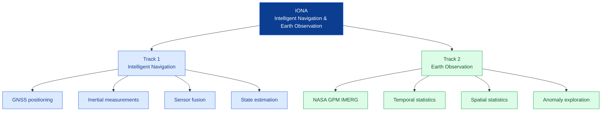
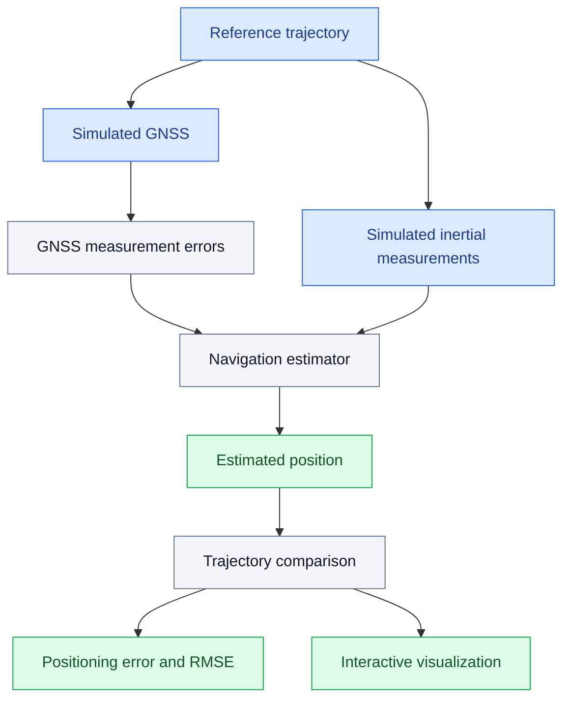
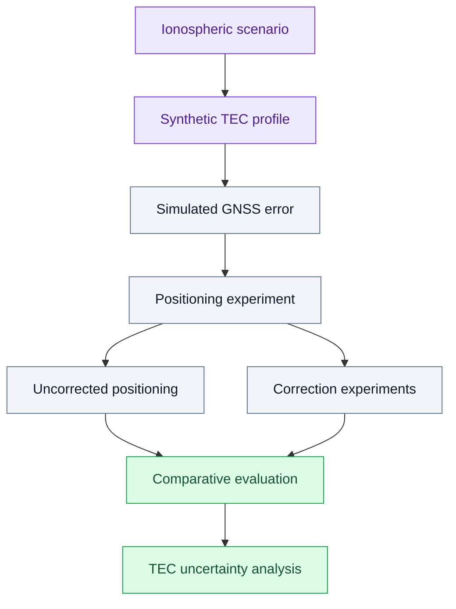
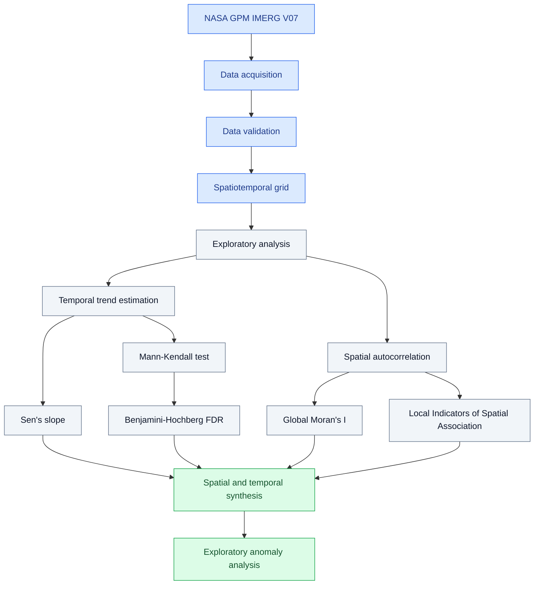

<div align="center">

# IONA
### Intelligent Navigation & Earth Observation Research

**A research platform exploring intelligent navigation, GNSS/IMU sensor integration, ionospheric effects, and spatiotemporal Earth observation.**

<br>

[](https://www.python.org/)
[](https://react.dev/)
[](https://www.typescriptlang.org/)
[](https://vite.dev/)
[](https://numpy.org/)
[](https://gpm.nasa.gov/data/imerg)
[](#-project-status)

<br>

**Research Project · Aerospace Engineering · Artificial Intelligence · Scientific Computing**

[Live Demo](https://iona-five.vercel.app/) ·
[Repository](https://github.com/el-pitchula/IONA) ·
[Navigation Research](#-research-track-1--intelligent-navigation) ·
[Earth Observation](#-research-track-2--earth-observation)

</div>

---

## Table of Contents

- [Overview](#-overview)
- [Research Scope](#-research-scope)
- [Research Track 1 — Intelligent Navigation](#-research-track-1--intelligent-navigation)
  - [Navigation Architecture](#navigation-architecture)
  - [GNSS/IMU Integration](#gnssimu-integration)
  - [Experimental Results](#experimental-results)
  - [Adaptive Filtering Experiments](#adaptive-filtering-experiments)
- [Research Track 2 — Earth Observation](#-research-track-2--earth-observation)
  - [NASA GPM IMERG Dataset](#nasa-gpm-imerg-dataset)
  - [Spatiotemporal Analysis](#spatiotemporal-analysis)
  - [Preliminary Findings](#preliminary-findings)
- [Web Demonstration](#-web-demonstration)
- [Technology Stack](#-technology-stack)
- [Repository Structure](#-repository-structure)
- [Installation and Execution](#-installation-and-execution)
- [Methodological Limitations](#-methodological-limitations)
- [Future Development](#-future-development)
- [Data Sources and References](#-data-sources-and-references)

---

## Overview

**IONA** is an experimental research project investigating the intersection of artificial intelligence, aerospace systems, navigation, and Earth observation.

The repository brings together two complementary research directions:

1. **Intelligent Navigation:** investigation of GNSS/IMU integration, positioning errors, ionospheric disturbances, sensor fusion, and filtering techniques for navigation continuity during GNSS signal degradation or outages.

2. **Earth Observation:** spatiotemporal analysis of precipitation data from NASA's Global Precipitation Measurement (GPM) mission, using statistical trend estimation, spatial autocorrelation, and exploratory anomaly detection.

These research tracks are maintained within the same repository as distinct experimental workstreams. They do not currently constitute a single integrated operational system.

The project also includes a web-based navigation demonstration designed to make trajectory estimation, GNSS outages, and positioning errors easier to visualize and investigate.

### Core Research Questions

| Research Area | Main Question |
| --- | --- |
| Intelligent Navigation | How can integrated navigation maintain a more reliable position estimate during GNSS degradation? |
| Sensor Fusion | How can measurements from different sensors be combined to reduce positioning uncertainty? |
| Ionospheric Effects | How can ionospheric disturbances influence GNSS positioning and its correction models? |
| Adaptive Estimation | How can filtering strategies respond to changes in measurement quality and uncertainty? |
| Earth Observation | How can long-term precipitation patterns be characterized through spatial and temporal statistics? |
| Anomaly Detection | How can unusual spatiotemporal patterns be identified and investigated in Earth observation datasets? |

---

## Research Scope

IONA is organized around two research tracks with different datasets, methods, and experimental objectives.



### Project Status

| Component | Status | Description |
| --- | --- | --- |
| Navigation web interface | Implemented | Interactive visualization of trajectories and positioning estimates |
| Synthetic GNSS/IMU experiment | Implemented | Simulated measurements and integrated navigation |
| Linear Kalman filter | Implemented | State estimation in the current mission simulation |
| Ionospheric disturbance model | Experimental | Synthetic TEC profiles and positioning-error experiments |
| Adaptive EKF | Experimental | Separate adaptive-filtering and validation studies |
| Monte Carlo analysis | Experimental | Repeated simulations for statistical evaluation |
| NASA GPM precipitation analysis | Implemented / research | Historical precipitation dataset and spatial-temporal analysis |
| EARTH-MIND anomaly exploration | Experimental | Exploratory anomaly-detection methodology |
| Unified navigation and Earth observation system | Future direction | No operational integration between the two tracks |

---

# Research Track 1 — Intelligent Navigation

## Intelligent Navigation Architecture

The navigation research investigates the use of multiple information sources to estimate the position of a moving platform.

GNSS provides absolute positioning information, while inertial measurements can support short-term motion estimation. Their integration can help maintain navigation continuity when satellite positioning becomes unavailable or unreliable.

The current experimental environment uses synthetic trajectories and simulated measurements to investigate this behavior.

### Navigation Architecture



## GNSS/IMU Integration

The integrated navigation experiment investigates positioning behavior under nominal and disturbed GNSS conditions.

The simulation includes:

- A synthetic two-dimensional reference trajectory.
- Simulated GNSS position measurements.
- Inertial measurements derived from the reference motion with Gaussian noise.
- GNSS availability and outage intervals.
- Position estimation using a simplified linear Kalman filter.
- Comparative analysis of multiple positioning estimates.

### Mission Simulation Parameters

| Parameter | Value |
| --- | --- |
| Total simulation time | 120 seconds |
| Number of samples | 6,001 |
| Sampling interval | 0.02 seconds |
| GNSS outage interval | 45–75 seconds |
| Trajectory | Synthetic 2D |
| Positioning environment | Simulated |
| Current integrated estimator | Linear Kalman filter |

### Positioning Scenarios

The experiments compare several positioning approaches:

| Method | Description |
| --- | --- |
| GNSS L1 | Simulated single-frequency GNSS positioning |
| IMU | Inertial propagation with simplified measurement noise |
| Kalman L1 | Integrated GNSS/IMU estimate using the linear Kalman filter |
| Ideal TEC correction | Reference experiment assuming exact knowledge of synthetic TEC |
| Dual-frequency-inspired | Simplified experiment inspired by dual-frequency GNSS correction |

The methods are intended for comparative investigation. They do not represent a complete operational GNSS receiver or a flight-qualified navigation system.

## Experimental Results

The following values correspond to the simulated GNSS outage interval, from 45 to 75 seconds.

### Disturbed Scenario

| Positioning Method | Outage RMSE |
| --- | ---: |
| GNSS L1 | 38.392 m |
| IMU | 98.928 m |
| Kalman L1 | 1.329 m |
| Ideal TEC correction reference | 0.274 m |
| Dual-frequency-inspired | 1.322 m |

### Quiet Scenario

| Positioning Method | Outage RMSE |
| --- | ---: |
| GNSS L1 | 38.048 m |
| IMU | 100.760 m |
| Kalman L1 | 1.691 m |
| Ideal TEC correction reference | 0.771 m |
| Dual-frequency-inspired | 2.274 m |

### Interpretation

The simulated results illustrate the accumulation of inertial positioning error during GNSS outages and the potential benefits of integrated state estimation.

The linear Kalman filter produces lower positioning RMSE than the standalone simulated GNSS and IMU estimates during the tested outage interval.

The ideal TEC correction experiment provides a reference for understanding the potential influence of ionospheric correction. However, it assumes exact knowledge of the synthetic TEC profile and should not be interpreted as an operational correction method.

The dual-frequency-inspired experiment is a simplified comparative model, not a complete implementation of a dual-frequency GNSS receiver.

> **Important:** These results are simulation-specific. They do not establish real-world navigation accuracy, operational robustness, or performance with physical GNSS receivers and IMUs.

## Ionospheric Modeling and TEC Experiments

The navigation research also investigates the influence of ionospheric disturbances on GNSS positioning.

Total Electron Content (TEC) is used as a conceptual and experimental parameter for studying ionospheric effects on satellite navigation signals.

The experiments include:

- Synthetic ionospheric profiles.
- Quiet and disturbed scenarios.
- Simulated GNSS positioning errors.
- TEC uncertainty analysis.
- Comparative correction experiments.
- Investigation of how positioning uncertainty affects state estimation.

The synthetic profiles are intended for controlled experiments. They are not observational measurements of the ionosphere.

### Ionospheric Research Pipeline



## Adaptive Filtering Experiments

In addition to the linear Kalman filter used in the current integrated navigation demonstration, the repository contains separate experiments involving adaptive Extended Kalman Filtering (EKF).

These studies investigate:

- Adaptive measurement uncertainty.
- Filter response to changing measurement quality.
- Estimation consistency.
- Innovation and residual diagnostics.
- Comparative filtering behavior.
- Validation under simulated disturbances.

The adaptive EKF experiments are independent research modules. Their results must not be confused with the metrics reported for the current web demonstration, which uses a linear Kalman filter.

---

# Research Track 2 — Earth Observation

## NASA GPM IMERG Dataset

The Earth observation research investigates long-term precipitation variability using data from NASA's Global Precipitation Measurement mission.

The dataset used is **GPM IMERG Monthly Final Run V07 (3IMERGM)**.

Official data source:

[ NASA GPM — IMERG Precipitation Data ](https://gpm.nasa.gov/data/imerg)

### Dataset Characteristics

| Parameter | Description |
| --- | --- |
| Mission | Global Precipitation Measurement (GPM) |
| Product | IMERG Monthly Final Run V07 |
| Product identifier | 3IMERGM |
| Temporal coverage | 2001–2024 |
| Temporal resolution | Monthly |
| Spatial resolution | 0.1° |
| Study grid | 25 × 25 cells |
| Number of spatial cells | 625 |
| Cell-month observations | 180,000 |
| Study region | Rectangular pilot region surrounding the Federal District, Brazil |

**Dataset DOI:** `10.5067/GPM/IMERG/3B-MON/07`

The selected region is a rectangular research window surrounding the Federal District. It should not be interpreted as an official Cerrado biome boundary.

## Spatiotemporal Analysis

The Earth observation pipeline combines temporal trend estimation and spatial statistics to investigate precipitation patterns.

### Analytical Workflow



### Temporal Methods

The temporal analysis includes:

- **Sen's slope:** robust estimation of the magnitude and direction of temporal trends.
- **Mann–Kendall test:** non-parametric evaluation of monotonic trends.
- **Benjamini–Hochberg FDR:** correction for multiple statistical comparisons.

### Spatial Methods

The spatial analysis includes:

- **Global Moran's I:** evaluation of spatial autocorrelation.
- **Local Indicators of Spatial Association (LISA):** investigation of local spatial clusters and outliers.
- **Queen contiguity:** neighborhood definition based on shared edges or vertices.
- **Rook contiguity:** neighborhood definition based on shared edges.
- **Spatial robustness analysis:** comparison of results under different neighborhood definitions.

## Preliminary Findings

The preliminary study covers monthly precipitation observations from 2001 to 2024.

| Indicator | Preliminary Result |
| --- | --- |
| Monthly observations | 288 |
| Spatial cells | 625 |
| Regional Sen's slope | Approximately −11.05 mm/year² |
| Regional trend significance | Not significant at 5% |
| Individual cell trends after FDR | No cells retained significant temporal trends |
| Global spatial autocorrelation | Strong positive autocorrelation in Sen's slopes |
| Local spatial classifications | Sensitive to neighborhood definition |

### Interpretation

The regional trend estimate is negative, but the analysis does not establish a statistically significant regional monotonic trend at the 5% significance level.

Likewise, no individual grid cell retained a statistically significant temporal trend after the multiple-testing correction.

The spatial analysis indicates positive spatial autocorrelation in the estimated Sen's slopes. This suggests that neighboring cells tend to exhibit similar trend estimates.

Local spatial classifications are sensitive to the neighborhood definition, reinforcing the importance of spatial robustness analysis.

These results are preliminary and specific to the selected study region, dataset, temporal coverage, and analytical procedures.

## EARTH-MIND — Exploratory Anomaly Analysis

The repository also contains an exploratory anomaly-detection research direction called **EARTH-MIND**.

Its purpose is to investigate unusual patterns in spatiotemporal precipitation data and provide additional analytical perspectives beyond conventional trend estimation.

The repository includes anomaly-analysis scripts and exported data products for further exploration.

EARTH-MIND is an experimental analytical component. Its outputs should not be interpreted as official climate alerts, operational forecasting products, or validated environmental diagnoses.

## STCI — Spatial-Temporal Coherence Index

The project explores a descriptive metric called the **Spatial-Temporal Coherence Index (STCI)**.

The experimental formulation is:

\[
STCI =
1 -
\frac{
\left|\sum_i w_i\beta_i\right|
}{
\sum_i w_i|\beta_i|
}
\]

Where:

- \(\beta_i\) represents the Sen's slope estimated for spatial cell \(i\).
- \(w_i\) represents the cosine-of-latitude weighting factor.
- The summations are performed over the selected spatial grid.

The metric is intended to describe the degree of cancellation between positive and negative spatial trend estimates.

**STCI is a project-defined experimental descriptive metric.** It is not an established climate index or a standardized scientific indicator.

---

# Web Demonstration

## Interactive Navigation Interface

The current public demonstration presents the navigation research through an interactive web interface.

<diV align="center">

**[Open IONA Web Demonstration](https://iona-five.vercel.app/)**

</div>

The interface focuses on visualizing the behavior of positioning estimates during a simulated mission.

### Main Capabilities

| Feature | Description |
| --- | --- |
| Navigation overview | Displays the mission and positioning context |
| Trajectory visualization | Shows the complete synthetic reference trajectory |
| Position estimates | Compares multiple simulated positioning solutions |
| Playback controls | Allows the user to play and pause the simulation |
| Time navigation | Enables navigation through the mission timeline |
| Synchronized visualization | Connects trajectory and positioning-error displays |
| GNSS outage demonstration | Highlights the interval in which GNSS measurements are unavailable |
| Comparative analysis | Allows visual investigation of estimator behavior |

### Demonstration Scope

The web application is a visualization of synthetic experimental data.

It does not currently process live satellite signals, physical IMU measurements, real GNSS receiver observations, or operational ionospheric data.

The interface is intended to make the research experiments accessible and interpretable.

---

# Technology Stack

## Scientific Computing and Research

| Technology | Application |
| --- | --- |
| Python | Scientific computing and experimental orchestration |
| NumPy | Numerical operations and array processing |
| Pandas | Dataset processing and analysis |
| SciPy | Scientific and statistical computation |
| Matplotlib | Scientific visualization |
| Jupyter Notebook | Interactive research and experimentation |
| Statistical methods | Trend estimation and spatial analysis |
| Kalman Filtering | Navigation state estimation |
| Extended Kalman Filtering | Separate adaptive estimation experiments |

## Web Application

| Technology | Application |
| --- | --- |
| React 19 | Interface development |
| TypeScript | Typed application logic |
| Vite | Development server and build tooling |
| CSS | Interface styling and visualization |
| Vercel | Public web deployment |
| Git and GitHub | Version control and project hosting |

---

# Repository Structure

The repository contains the web application, scientific analysis scripts, experimental datasets, and research documentation.

The structure below is a functional overview of the main research areas; individual experimental files and generated outputs may vary as the project evolves.

```text
IONA/
│
├── analysis/
│   │
│   ├── ionosphere_gnss_model.py
│   ├── ionosphere_positioning_experiment.py
│   ├── iona_tec_uncertainty.py
│   │
│   ├── iona_adaptive_ekf.py
│   ├── iona_adaptive_ekf_validation.py
│   ├── iona_integrated_navigation.py
│   │
│   ├── gnss_imu_experiment.py
│   ├── gnss_imu_monte_carlo.py
│   │
│   ├── build_spatiotemporal_dataset.py
│   ├── download_data.py
│   ├── exploratory_analysis.py
│   ├── generate_scientific_figures.py
│   │
│   ├── spatial_trend_analysis.py
│   ├── spatial_autocorrelation.py
│   ├── spatial_robustness.py
│   ├── earth_mind_anomaly.py
│   └── export_earth_mind_v2.py
│
├── data/
│   └── metadata/
│       ├── gpm_imerg_download.json
│       ├── gpm_imerg_historical_acquisition.json
│       ├── gpm_imerg_validation_report.csv
│       └── spatiotemporal_dataset.json
│
├── docs/
│   ├── figuras/
│   ├── relatorio.pdf
│   └── relatorio_cientifico.tex
│
├── public/
│   └── data/
│       ├── annual_series.json
│       ├── data_quality.json
│       ├── earth_mind_anomalies.geojson
│       └── earth_mind_monthly.json
│
├── results/
│   └── integrated_navigation/
│       └── mission_timeseries.csv
│
├── src/
│   ├── App.tsx
│   ├── App.css
│   └── ...
│
├── package.json
├── tsconfig.json
├── vite.config.ts
├── README.md
└── ...
```

### Important Research Files

| File | Purpose |
| --- | --- |
| `analysis/iona_integrated_navigation.py` | Integrated navigation simulation |
| `analysis/iona_adaptive_ekf.py` | Adaptive EKF experiments |
| `analysis/iona_adaptive_ekf_validation.py` | Adaptive EKF validation |
| `analysis/gnss_imu_experiment.py` | GNSS/IMU experimental analysis |
| `analysis/gnss_imu_monte_carlo.py` | Monte Carlo experiments |
| `analysis/iona_tec_uncertainty.py` | TEC uncertainty analysis |
| `analysis/ionosphere_gnss_model.py` | Ionospheric and GNSS modeling |
| `analysis/build_spatiotemporal_dataset.py` | Construction of the Earth observation dataset |
| `analysis/spatial_trend_analysis.py` | Spatial trend estimation |
| `analysis/spatial_autocorrelation.py` | Spatial autocorrelation analysis |
| `analysis/spatial_robustness.py` | Robustness analysis under different spatial definitions |
| `analysis/earth_mind_anomaly.py` | Exploratory anomaly analysis |
| `results/integrated_navigation/mission_timeseries.csv` | Synthetic mission time series used by the navigation demonstration |

---

# Installation and Execution

## 1. Clone the Repository

```bash
git clone https://github.com/el-pitchula/IONA.git

cd IONA
```

## 2. Run the Web Application

The web application uses Node.js, React, TypeScript, and Vite.

```bash
npm install

npm run dev
```

Vite will display the local development address in the terminal.

## 3. Build for Production

```bash
npm run build
```

## 4. Run Code Quality Checks

```bash
npm run lint
```

## 5. Python Research Environment

The scientific analysis scripts use Python.

Create a virtual environment:

```bash
python -m venv .venv
```

Activate it on Windows:

```powershell
.venv\Scripts\Activate.ps1
```

Activate it on Linux or macOS:

```bash
source .venv/bin/activate
```

Install the required scientific dependencies according to the dependencies used by the individual research scripts.

```bash
pip install numpy pandas scipy matplotlib jupyter
```

> Some experimental modules may require additional dependencies. Check the imports and configuration of the specific script before execution.

---

# Methodological Limitations

IONA is a research and prototyping repository. Its experimental results must be interpreted within the assumptions and limitations of each research track.

## Navigation Limitations

- The current integrated navigation experiment uses synthetic trajectory and measurement data.
- The GNSS and IMU models are simplified and do not represent a complete physical receiver or inertial navigation unit.
- The IMU model uses simplified acceleration measurements with Gaussian noise.
- Explicit gyroscope modeling, attitude estimation, calibration, and detailed sensor bias modeling are not part of the current integrated demonstration.
- The ionospheric profiles are synthetic and are not observational measurements.
- The ideal TEC correction assumes exact knowledge of the synthetic TEC profile.
- The dual-frequency-inspired method is a simplified experiment, not a complete operational dual-frequency receiver.
- The current web demonstration uses a linear Kalman filter. Separate adaptive EKF experiments are documented independently.
- No real-time GNSS receiver, physical IMU, or flight-tested navigation platform is currently integrated.

## Earth Observation Limitations

- The study uses a selected rectangular pilot region surrounding the Federal District.
- The selected region is not an official Cerrado biome boundary.
- The results depend on the temporal and spatial resolution of the GPM IMERG product.
- The regional trend estimate is not statistically significant at the 5% level.
- No individual cell retained a significant temporal trend after FDR correction.
- Local spatial classifications can change according to the neighborhood definition.
- STCI is an experimental project-defined metric, not a standardized scientific index.
- EARTH-MIND is an exploratory anomaly-analysis direction, not an operational climate alert system.

## General Limitations

The two research tracks are maintained as separate experimental workstreams.

Their methods, datasets, results, and assumptions should be evaluated independently. The presence of both within the same repository does not imply that they have already been integrated into a unified operational architecture.

---

# Future Development

IONA is intended to evolve through additional experimental validation, improved modeling, and integration with real-world data sources.

## Intelligent Navigation

- [ ] Validate positioning models with real GNSS observations.
- [ ] Investigate GNSS data from NASA CDDIS and other scientific repositories.
- [ ] Improve the physical representation of ionospheric effects.
- [ ] Investigate real dual-frequency GNSS correction models.
- [ ] Incorporate more complete inertial sensor models.
- [ ] Expand attitude estimation and sensor calibration.
- [ ] Evaluate adaptive EKF behavior under additional disturbance scenarios.
- [ ] Investigate quaternion-based attitude representation.
- [ ] Explore navigation architectures for autonomous aerial platforms.
- [ ] Compare simulation results against real experimental measurements.

## Earth Observation

- [ ] Expand the geographic study area.
- [ ] Investigate additional GPM products and complementary Earth observation datasets.
- [ ] Evaluate the sensitivity of spatial statistics to grid resolution.
- [ ] Improve anomaly-detection validation.
- [ ] Investigate the reproducibility of local spatial classifications.
- [ ] Further evaluate the experimental STCI formulation.
- [ ] Explore complementary environmental variables.

## Platform and Research Infrastructure

- [ ] Improve automated experiment reproducibility.
- [ ] Standardize metadata and experiment configurations.
- [ ] Expand scientific documentation and visual reports.
- [ ] Improve the interactive web interface.
- [ ] Develop additional comparative visualization tools.
- [ ] Organize independent research modules into clearer packages.

---

# Data Sources and References

## NASA Resources

**Global Precipitation Measurement (GPM)**

NASA's GPM mission provides global precipitation observations and derived products for Earth system research.

- Official portal: https://gpm.nasa.gov/
- IMERG documentation: https://gpm.nasa.gov/data/imerg
- Product: GPM IMERG Monthly Final Run V07 (3IMERGM)
- DOI: `10.5067/GPM/IMERG/3B-MON/07`

**NASA CDDIS — Future Navigation Validation Resource**

The NASA Crustal Dynamics Data Information System (CDDIS) is a potential source for future GNSS-related validation and research.

- Official portal: https://cddis.nasa.gov/

CDDIS is identified here as a possible future data source. Its observational products are not claimed as inputs to the current synthetic navigation experiment.

## Scientific Methods

The research draws on established methods and concepts in:

- Kalman filtering and state estimation.
- Inertial navigation and GNSS integration.
- Total Electron Content and ionospheric effects on satellite navigation.
- Sen's slope and non-parametric trend estimation.
- Mann–Kendall trend testing.
- Benjamini–Hochberg false discovery rate correction.
- Global and Local Moran's spatial autocorrelation.
- Spatial neighborhood definitions and robustness analysis.

---

<div align="center">

## IONA

**Exploring the intersection of intelligent navigation, aerospace systems, and Earth observation.**

<br>

[](https://github.com/el-pitchula/IONA)
[](https://iona-five.vercel.app/)

<br>

*Research, experimentation, and scientific exploration.*

</div>
